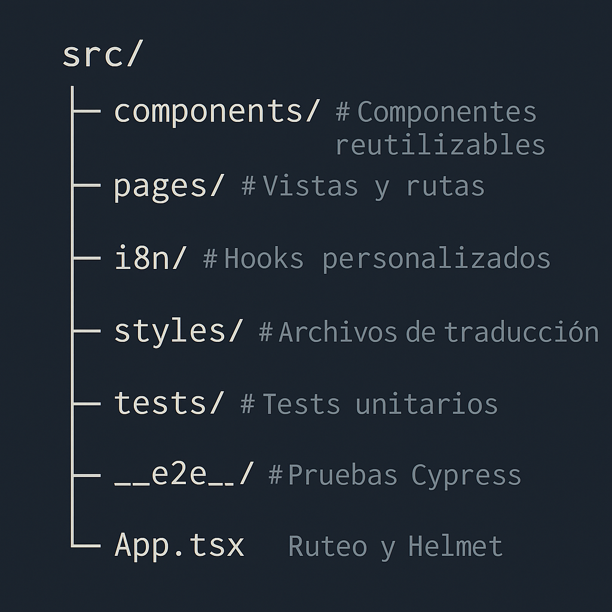

# 🚀 Invest Alerts – React Frontend

Professional frontend for the **Invest Alerts** system, a crypto price alerting app built with React 19 + Vite. This project is designed to be **modern, scalable, and world-class** — ideal as a base template or for real production projects.

---

## 📊 Badges

[](https://github.com/marcoslozina/invest-alerts-reactive-frontend/actions)
[](https://codecov.io/gh/marcoslozina/invest-alerts-reactive-frontend)
[](https://invest-alerts-reactive-frontend.vercel.app/)


---

## ✨ Implemented Features

✅ Modularization with a layered structure
✅ Tailwind CSS 4
✅ Internationalization (`i18next`, `react-i18next`)
✅ SEO with `react-helmet-async`
✅ Global error boundaries
✅ Lazy loading and `React.Suspense`
✅ E2E testing with Cypress
✅ Unit testing with **Jest** + Testing Library
✅ Backend mock server for tests
✅ CI/CD with GitHub Actions + Vercel
✅ Automatic coverage with **Codecov**
✅ Storybook 9 for UI components
✅ Husky + lint-staged for pre-commits
✅ ESLint + Prettier integrated
✅ React 19 compatibility

---

## 🧰 Main Technologies

- ⚛️ React 19 (with TypeScript)
- ⚡ Vite
- 🌐 React Router 7
- 🎨 Tailwind CSS
- 🧪 Jest + React Testing Library
- 🧪 Cypress (E2E)
- 📚 Storybook 9
- 🌍 i18next (multi-language)
- 🔒 Husky + lint-staged
- 💡 react-helmet-async
- 📦 Axios
- ☁️ GitHub Actions + Codecov + Vercel

---

## 🚀 Available Scripts

```bash
npm run dev         # Run the app in development mode
npm run build       # Build for production
npm run preview     # Serve the build locally
npm run lint        # Run ESLint
npm run format      # Format with Prettier
npm run test        # Run unit tests with Jest
npm run coverage    # Generate coverage report
npm run e2e         # Open Cypress
npm run storybook   # Open Storybook on localhost:6006
```

---

## 📁 Project Structure



---

## 🌍 i18n (languages)

The project is set up for internationalization. Available languages:

- 🇺🇸 English (`en`)
- 🇪🇸 Spanish (`es`)

You can add new languages by editing the `src/locales/` folder.

---

## 🧪 Tests and Coverage

- Unit tests with **Jest**
- Backend mocking using `__mocks__` and `jest.mock(...)`
- E2E tests with **Cypress**
- Coverage automatically published to [Codecov](https://codecov.io/gh/marcoslozina/invest-alerts-reactive-frontend)

---

## 📦 Automatic Deploy

The project deploys automatically to [Vercel](https://vercel.com/dashboard) on every push to the `main` branch.

---

## 📄 License

MIT © [Marcos Lozina](https://github.com/marcoslozina)
